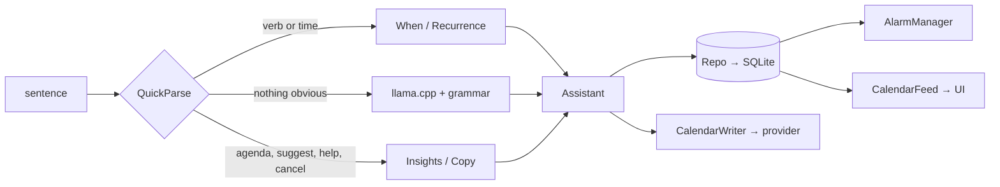

# Agent notes — read this first

You should not need to read the whole codebase. It is ~5.9k lines of Kotlin/C++; this file tells you
which ~300 lines matter for a given task. Public documentation is `README.md`; the backlog of known
gaps is `docs/LIMITATIONS.md`; measured evidence is `docs/VERIFICATION.md`.

## What this is

Morrow — an offline Android assistant. A typed English or French sentence becomes a task or calendar
event, with a reminder; a bundled 270 M model handles sentences the rules cannot structure. There is
no `INTERNET` permission and no third-party SDK.

## Where things live

| If you are touching… | Read | ~LOC |
|---|---|---|
| Time words ("tomorrow 5pm", "vendredi à 15h", "in 3 days at 9am") | `domain/When.kt` | 435 |
| Verb patterns / routing / "two actions in one sentence" | `domain/QuickParse.kt` | 232 |
| Repetition rules and occurrence top-up | `domain/Recurrence.kt` | 204 |
| Replies, agenda text, insights wording (EN/FR) | `domain/Copy.kt` | 357 |
| Orchestration: which branch runs, title validation, series creation | `domain/Assistant.kt` | 364 |
| Local suggestions (overdue, free gap, crowded day) | `domain/Insights.kt` | 155 |
| Model prompt + GBNF grammar | `llm/FunctionGemma.kt` (75) + `llm/CallParser.kt` (39) | 114 |
| Engine lifecycle, threading, unload policy | `llm/LlamaEngine.kt` | 154 |
| JNI bridge (llama.cpp) | `cpp/llm_bridge.cpp` + `cpp/CMakeLists.txt` | 250 |
| SQLite schema, migrations, read/write | `data/Store.kt` (143) + `data/Model.kt` (60) | 203 |
| In-memory state + undo | `data/Repo.kt` | 158 |
| Reminders / alarms / notification actions | `notify/Reminders.kt` + `notify/Receivers.kt` | 200 |
| System calendar read-back | `calendar/CalendarFeed.kt` | 139 |
| System calendar write | `calendar/CalendarWriter.kt` | 83 |
| Model asset unpack + sha256 | `model/ModelPack.kt` | 117 |
| Navigation, sheet actions, permissions | `ui/Root.kt` | 469 |
| Screens | `ui/TodayScreen.kt` (245), `ui/AskScreen.kt` (245), `ui/SettingsScreen.kt` (299), `ui/SetupScreen.kt` (136) | 925 |
| Theme, shared widgets | `ui/theme/Theme.kt`, `ui/Components.kt` | 391 |
| Wiring (8 objects, no Hilt) | `MorrowApp.kt` | 86 |

Tests are the specification for the pure logic: `WhenTest`, `QuickParseTest`, `RecurrenceTest`,
`InsightsTest`, `CalendarFeedTest`, `FunctionGemmaTest`, `ModelPackInfoTest` (75 tests).

## Invariants — do not "improve" these casually

1. **Rules first, model last.** `QuickParse.route()` answers most sentences; `Assistant.think()` is the
   fallback. Never route more traffic to the model to fix a phrasing — extend the rules.
2. **The app decides task vs event; the grammar enforces it.** `FunctionGemma.grammar(forcedKind)`
   narrows output to one alternative. Keep it that way.
3. **Never put user data in the model prompt.** Feeding agenda/memories into the prompt was measured
   to make the 270 M model choose the wrong tool (numbers in README).
4. **Model output is untrusted.** It goes through `CallParser`, `acceptableTitle()` and
   `When.cleanTitle`. Do not remove the validation; it caught a model writing a refusal as a title.
5. **All user-visible text is localised.** Domain sentences go through `Copy`; UI strings live in
   `res/values/strings.xml` + `values-fr/strings.xml`. Adding a hardcoded English string is a bug.
6. **Time is never computed by the model.** `When` resolves it; spans are 1:1 on an accent-folded copy,
   and `cleanTitle` merges overlapping spans before deleting.
7. **Repetition is materialised.** Each occurrence is a real row (`rrule`, `series_id`). Top-up
   (`Recurrence.missingOccurrences`) must stay bounded, idempotent and serialised — a race here
   duplicated rows on hardware.
8. **Schema changes need a migration.** Bump `Store.DATABASE_VERSION` and extend `onUpgrade`; the
   v1→v2 path rebuilds the table because `ALTER TABLE … DROP COLUMN` needs Android 14.
9. **Calendars only through `CalendarProvider`.** No Google/Samsung SDK, no OAuth, no network.
10. **Two actions max per sentence** (`QuickParse.splitActions`). Splitting is only allowed when both
    halves contain a verb; that guard is what keeps "meeting with Anna and Sam" intact.

## Data flow



## Build, test, run

```bash
export JAVA_HOME=/path/to/jdk-21              # 17 and 21 are supported by AGP 9.4; only 21 was tested
export ANDROID_HOME=/path/to/Android/Sdk
./gradlew testDebugUnitTest lintDebug assembleDebug   # ~15 s warm, first build compiles llama.cpp
./gradlew assembleRelease                             # R8; unsigned
adb -s <serial> install -r -g app/build/outputs/apk/debug/app-debug.apk
```

Needs SDK 37, NDK `29.0.14033849`, CMake `3.31.6`. The 278 MB model is fetched once by
`./gradlew fetchModel` (URL + sha256 in `gradle.properties`; not committed). `abiFilters` builds
arm64-v8a and x86_64, the latter so emulators work.

## Cheap ways to prove behaviour

- **Read the app's database** (device or emulator, debug build):
  `adb -s <serial> shell run-as dev.morrow.debug cat databases/morrow.db > /tmp/m.db`, then query
  `items` / `turns` with sqlite3. This was the oracle for every verification claim.
- **UI oracle**: `adb shell uiautomator dump /sdcard/u.xml` + grep `text="…"`. Screenshots are useless
  to a text-only model.
- **Logcat**: `MorrowEngine` prints `prefill N tok in X ms, decode N tok in Y ms`; `MorrowCalendar`
  prints provider failures (silent otherwise).
- Emulator AVD is `morrow`; tests that need the real provider/camera/perf belong on a phone.

## Traps that cost real time

| Symptom | Cause |
|---|---|
| Gradle/AGP fails at startup | `JAVA_HOME` points at a JDK newer than 21; set it to 21 |
| llama.cpp compile error "cannot use try with exceptions disabled" | `-fno-exceptions` leaked onto third-party code; it belongs only on the bridge target |
| French UI still English | `localeFilters` in `app/build.gradle.kts` must include `"fr"`; also `android:localeConfig` enables per-app language |
| "Configuration cache problems … script object references" | don't capture script values in task actions; `fetchModel` delegates to a shell script |
| Calendar read returns 0 events but the provider has rows | `Instances` has no `status` column — asking for it throws and `runCatching` hides it |
| Tapping a mirrored event does nothing | missing `<queries>` for the calendar `VIEW` intent (Android 11+ package visibility) |
| `adb shell input text` sends nothing | apostrophes/quotes break the device shell — type accent/apostrophe-free phrases |
| Old reminders keep firing after `pm clear` | alarms outlive data; uninstall to clear them |
| UI automation taps nothing | keyboard shifts the nav bar / row is off-screen; hide the IME (`keyevent 4`) and prefer the last matching node |

## Definition of done

1. `./gradlew testDebugUnitTest lintDebug assembleRelease` green.
2. For behaviour changes, install and prove it from the DB or a UI dump — not by re-reading the code.
3. Update `README.md` (capabilities/limits), `docs/LIMITATIONS.md` (if a limit changed) and add a
   `CHANGELOG.md` entry.
4. If you touch the prompt or grammar, the goldens in `app/src/test/resources/` must be regenerated
   *and* re-validated against the real GGUF (see `docs/VERIFICATION.md`).
