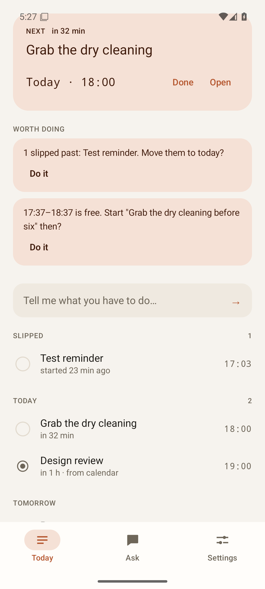
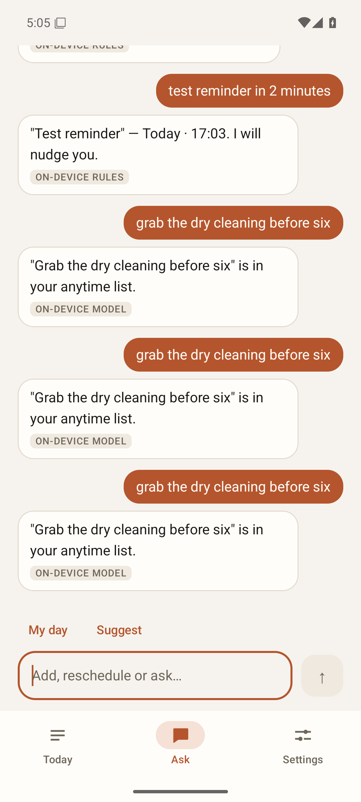
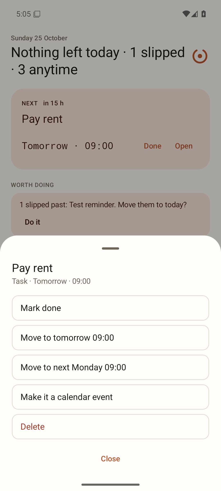
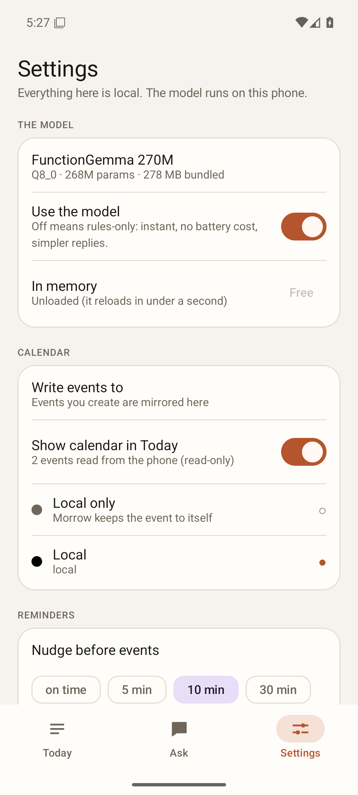
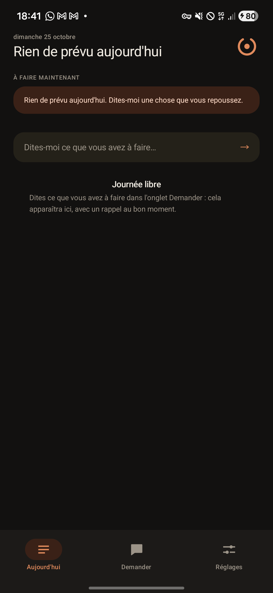
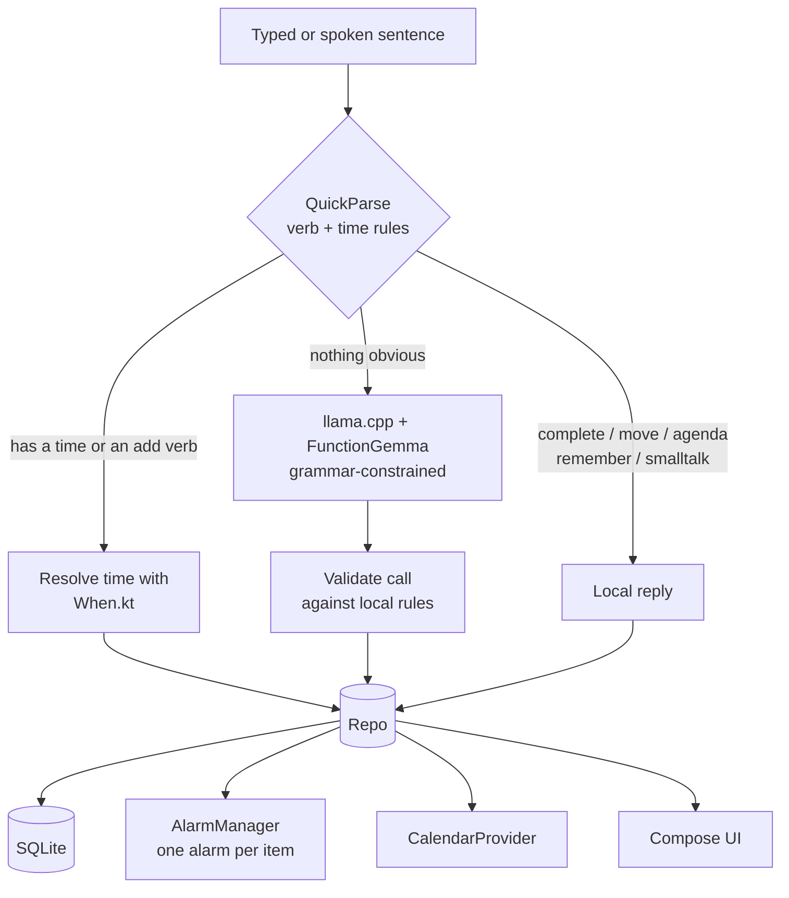

# Morrow

Your day, kept on this phone.

Morrow is a small Android app that turns what you say into tasks, calendar events and reminders,
using a **270M-parameter model that ships inside the APK**. No account, no API key, no network
permission. You install it and it works.

```text
"I have to pick up the dry cleaning tomorrow at 5"
        → task "Pick up dry cleaning" · Tomorrow 17:00 · reminder at 16:55

"dentist on friday at 3pm"
        → calendar event "Dentist" · Fri 15:00 · mirrored into your system calendar

"done with the rent"      → ticked off
"move pay rent to monday" → moved to Monday 09:00
"what's on my plate?"     → today, in one sentence
```

Built as a deliberate counter-design to [opendroid](https://github.com/yashab-cyber/opendroid): same
idea (local-first assistant on the phone), a fraction of the moving parts (3 screens, 8 objects, no annotation processors), and a calm Material 3
surface instead of neon glassmorphism.

| Today | Ask | Detail sheet | Settings |
|---|---|---|---|
|  |  |  |  |
| **En français** | | | |
|  | | | |

*(Screenshots are real captures from the emulator used for verification, 1080×2400.)*

---

## Why this design

The interesting problem is not "can a phone run an LLM"; it is "which parts of an assistant should
not be an LLM at all".

**A 270M model cannot do calendar arithmetic, and should not be asked to.** It happily emitted
`2024-07-30T18:00:00` for "tomorrow at 5" (measured, see below), and when it chose among four
tools it was right 9–13 times out of 24. So:

| Job | Who does it | Why |
|---|---|---|
| Time expressions ("friday 3pm", "dans 2 heures") | `When.kt`, ~450 lines of plain Kotlin | deterministic, testable, no battery |
| Repetition ("every monday", "tous les lundis") | `Recurrence.kt` → iCalendar rules + rows | alarms and completion keep working unchanged |
| Two actions in one sentence ("pay rent and call the dentist") | `QuickParse.splitActions` | only when *both* halves have a verb |
| Two languages (EN/FR) | `Copy.kt` + `values-fr/` | rules and UI are translated; the model is not |
| Choosing task vs event vs note | vocabulary rules + one-tap override | a 270M model is coin-flip bad at it |
| "done with X", "move X to Y", "what's on my plate" | `QuickParse.kt` verb patterns | these never need a model |
| Suggestions | `Insights.kt` (overdue, free gap, empty day) | computed at screen open; no background work |
| **Messy sentences** ("swap the winter tyres") | **the model** | exactly what small LLMs are good at: extracting the gist |
| Reminders | `AlarmManager` + one broadcast receiver | OS wakes us once, per item |

The model's whole job is: *sentence → `save(kind, text)` or `reply(text)`*, in its own native
function-call syntax, constrained by a GBNF grammar. When the rules already know the kind, the
grammar is narrowed so only that alternative is reachable: the model literally cannot drift.

### Measured evidence for that split

Run against the bundled GGUF with `llama.cpp` (greedy, grammar-constrained):

| Prompt shape | Result |
|---|---|
| 4 free tools (add_task / add_event / complete / remember / answer) | 9/24 intent accuracy, 13/24 with few-shot |
| 1 tool with a `kind` enum | 11/19, and it never once picked `event` |
| 1 tool, kind forced by rules + grammar | **14/14 parseable**, correct kind, clean titles |
| Injecting agenda context into the user turn | actively harmful: the model answered with the first open task |

That is why the app never puts your data in the prompt.

---

## Architecture



* **`domain/`**: pure Kotlin, no Android imports. `When` (time), `Recurrence` (repetition),
  `QuickParse` (routing), `Insights`, `Assistant` (orchestration), `Copy` (EN/FR sentences), `Fmt`.
  Everything here is unit-tested on the JVM.
* **`llm/`**: `Llama` (JNI surface), `LlamaEngine` (load/unload policy), `FunctionGemma`
  (prompt + grammar), `CallParser` (tolerant parser).
* **`data/`**: one SQLite helper, one repository, observable `Snapshot`, `Settings`.
* **`notify/`**, **`calendar/`**, **`model/`**, **`ui/`**: thin, single-purpose.
* No Hilt, no Room, no navigation library, no annotation processors: the graph is
  [eight constructor calls](app/src/main/java/dev/morrow/MorrowApp.kt), the database is three
  tables, and navigation is one `enum`.

---

## The model

| | |
|---|---|
| Model | `FunctionGemma 270M IT`: a Gemma 3 270M fine-tuned for function calling |
| Quant | Q8_0 · 268M params · **291,557,792 bytes (278 MiB)** |
| Source | `ggml-org/functiongemma-270m-it-GGUF` (sha256 `83940d4d…5270`) |
| Runtime | `llama.cpp` **b11879**, arm64 + x86_64, CPU only, built from a checksum-pinned tarball |
| Context | 1024 tokens (prompt is 193), batch 128, `n_outputs_max = 1` |
| Decoding | greedy + GBNF grammar, hard cap 64 new tokens |
| Licence | Gemma Terms of Use (runtime MIT) |

Why Q8_0 and not Q4: 270M at 8 bit is 278 MiB and *already* the smallest credible function-calling
model; published quants below Q8 do not exist for this checkpoint, and hand-quantising a model that
must emit exact token syntax is not worth 80 MiB. The bundle size is the honest trade for "install
and use it immediately".

### What it costs

Measured on a **Samsung Galaxy S21 FE (SM-G990B), Android 16, arm64-v8a** (the build that ships to
phones) and on the x86_64 emulator used for UI testing (4 vCPU, KVM, **no AVX dispatch**; the x86
build is deliberately baseline so it runs everywhere):

| Metric | Galaxy S21 FE (arm64) | Emulator (x86_64) |
|---|---|---|
| Prefill, ~191 tokens | **565 ms** (338 tok/s) | 1.6–2.5 s |
| Decode, ~21 tokens | **1.36 s** (≈15.5 tok/s) | 3.5–4.8 s |
| Whole model request (warm) | **1.93 s** | 5.2–7.3 s |
| Tap → reply, cold (incl. load) | **3.1 s** | not measured |
| PSS with model resident | **477 MB** (incl. 278 MB mapped) | ~440 MB |
| Rules-only request | ~1 ms | ~1 ms |
| 303 MB APK over USB | ~14 s | n/a |

The earlier emulator-only table for the release build:

| Metric | Debug build | Minified (R8) build |
|---|---|---|
| First load (mmap) | ~0.6 s | ~0.6 s |
| Prefill, 191–193 tokens | 2.5 s | 1.6–2.2 s |
| Decode, 21–23 tokens | 4.8 s | 3.5 s |
| Whole model request | 7.3 s | 5.2–5.8 s |
| PSS with model resident | ~440 MB (incl. 278 MB mapped weights) | same |
| Rules-only request | ~1 ms | ~1 ms, no model |

That is 2.7–3.8× faster than the emulator, in line with the estimate that was written before
hardware was available. The output cap (64 tokens) and the rules-first split are what actually keep
the cost bounded: most interactions never load the model at all.

### Memory / battery policy

1. Nothing runs at boot. The model loads on first *model* request, not at launch.
2. Unloads after 90 s idle, on `ON_STOP`, and on `onLowMemory()`; the `mmap` pages go back to the
   kernel immediately.
3. `n_outputs_max = 1` keeps the logits buffer at one row (1 MiB instead of 0.5 GiB for a
   262k vocabulary, measured 523 MiB → ~40 MiB compute buffer).
4. Greedy + grammar: no sampling loops, no retries on malformed output.
5. Decode uses 2 threads (memory-bound), prefill bursts to 4 (compute-bound), capped at 4.
6. Reminders are `setExactAndAllowWhileIdle` (or inexact fallback). No foreground service, no
   wake locks, no polling, no WorkManager.
7. The model is unpacked from the APK exactly once into `noBackupFilesDir` (excluded from cloud
   backup) with a SHA-256 check, so weight pages are never re-verified on later launches.

---

## Repeating things

"gym every monday at 7pm" / "yoga tous les lundis à 19h" understood without the model:

| Rule | English | French |
|---|---|---|
| daily | "every day" | "tous les jours" |
| weekdays | "every weekday" | "en semaine" |
| weekly on days | "every monday" | "tous les lundis" |
| interval | "every 2 weeks" | "toutes les 2 semaines" |
| monthly | "every month" | "tous les mois" |

Each occurrence is a **real row**: 8 up front, topped up to a 21-day horizon on launch (capped at 14),
so one alarm per occurrence, completion per occurrence and deletion per occurrence all work with no
special cases. The first occurrence is aligned to the rule ("tous les lundis" said on a Sunday starts
on Monday, not tonight), and top-up is idempotent, so relaunching never duplicates a day.

Anything else ("every 3rd tuesday", end dates) is saved once and you are told it cannot repeat that
pattern. Repeating items stay local; they are not written into the system calendar.

## Where it breaks (measured on the phone)

Each row below was typed into the installed app on the Galaxy S21 FE and the result read back from its
database, not from memory of the code.

| Input | What the app actually did |
|---|---|
| `pay the rent friday at 5pm` | task, Fri 17:00, alarm at 17:00 |
| `pay the rent and call the dentist tomorrow` | **two** items ("Pay the rent" anytime, "Call the dentist" tomorrow 09:00), no model call |
| `payer le loyer et appeler le dentiste demain` | same, in French |
| `call the plumber in 3 days at 9am` | Wed 09:00; the offset date **and** the explicit clock |
| `in 3 days at 9am` (no subject) | asks "What should I call the thing at Wed 28 Oct · 09:00?" instead of inventing a title |
| `dinner with Julia next tuesday at 8 for 2 hours` | event, 20:00–22:00 |
| `water the plants every day at 8am` | 14 occurrences (8 up front, topped up, capped), all distinct starts |
| `every 3rd tuesday at 10` | ⚠️ saved as a one-off **and told you** it cannot repeat that pattern |
| `j ai deja paye le loyer` / `i already paid the rent` | ticks off the *closest* matching item, not the longest one |
| `what is on my plate tomorrow` / `mon programme demain` | "Tomorrow: 3 things" / "Demain : 3 choses", then the list |
| `I need to remember to pick up the prescription … before they close at 7 on friday` | one task, Fri 19:00, title trimmed to "Pick up the prescription at the pharmacy before they close" |
| `cancel my gym session` | ⚠️ refused with "I cannot cancel or delete yet…" rather than saving junk |
| `half past five` | ⚠️ no idiom parsing; the model saves it as an anytime task with that text |
| `le 3` / `manana a las 3` | ⚠️ nothing saved; the model echoes the text back |
| three actions in one sentence | ⚠️ only the first two are split; the rest stays in the remaining title |
| `move it to tomorrow` (no name) | ⚠️ no conversational memory: the item's name has to be repeated |

## Languages

The whole interface and the whole rules layer are English and French, and the app follows the system
language. Per-app language is supported (`android:localeConfig`), so French can be chosen in Android
Settings → Apps → Morrow → Language without changing the phone; that is how it was verified on the
S23-era Samsung used for testing, while the phone itself stayed English. Typing without accents works
("demain a 15h").

The bundled model is **English-trained**. In French it is only asked to copy the user's words into the
item title (verified: "acheter du lait" → « Acheter du lait »), while time, repetition,
task-vs-event, agenda and suggestions come from the translated rules. Free-form French chat is terse
and may answer in English; the rules never do.

## Calendar, in both directions

Morrow talks to Android's `CalendarProvider` and nothing else. That is the single integration point
Google Calendar, Samsung Calendar, Etar and anything else on the phone already share; there is no
Google API client, no OAuth, no account picker, no network. Whichever calendars the phone has
(`you@gmail.com`, Samsung's local "My calendar", Exchange, DAVx5…) appear in Settings, whatever
their account type.

**Writing.** Pick a calendar and events are inserted there; deleting an item deletes its event,
rescheduling updates it. "Local only" is the default, so nothing leaves the app until you choose.

**Reading.** Today also shows the calendar you already keep: the next 30 days of occurrences are
read live from the provider, rendered as read-only rows (a dot instead of a checkbox, `· from
calendar`), and included in "next up", the agenda answer and free-slot suggestions. Without this,
"you are free 14:00–16:00" would cheerfully suggest a slot Google already booked.

Rules that keep it honest:
* rows Morrow wrote are matched by `calendarEventId` and not shown twice;
* mirrored rows are never written to the database and cannot be ticked off or moved from Morrow;
  tapping one opens the owning calendar app at that event;
* the switch *Show calendar in Today* hides them and stops the queries (default on);
* refresh happens on resume and every five minutes while visible; no background sync, no wakelocks;
* recurring series are expanded by the provider, so each occurrence appears separately (Morrow does
  not create recurring events itself).

## Privacy

* No `INTERNET` permission is declared; verified with `aapt2 dump permissions` on the built APK.
  Nothing you type *can* leave the device.
* Backups are disabled (`allowBackup=false`) and the model lives in `noBackupFilesDir`.
* Chat history is capped at 60 turns and can be cleared; remembered facts are listed and deletable.

---

## Build

Requirements: JDK 17–21, Android SDK 37, NDK `29.0.14033849`, CMake `3.31.6` (all installable with
`sdkmanager`), ~2 GB free disk for the native build.

```bash
# first run downloads the 278 MiB model into app/src/main/assets/models and verifies its sha256
./gradlew assembleDebug

adb install -r app/build/outputs/apk/debug/app-debug.apk

./gradlew testDebugUnitTest    # 75 JVM tests: parser, router, prompt/grammar, insight and model metadata
./gradlew assembleRelease      # minified, unsigned; sign with your own key
```

The first build compiles `llama.cpp` for `arm64-v8a` and `x86_64` (the latter so the same APK runs
on emulators); trim `abiFilters` to `arm64-v8a` for a release that ships to phones only.

### Swapping the model

`gradle.properties` is the single source of truth:

```properties
morrow.modelFile=functiongemma-270m-it-q8_0.gguf
morrow.modelBytes=291557792
morrow.modelSha=83940d4dd9676710856f43523bed096164a595a96f6b34771610a03937de5270
morrow.modelUrl=https://huggingface.co/ggml-org/functiongemma-270m-it-GGUF/resolve/main/functiongemma-270m-it-q8_0.gguf
```

`ModelPack.Info` must agree with these, and `ModelPackInfoTest` fails the build if they drift.
Point the properties at another GGUF and adjust `FunctionGemma`'s prompt/grammar to that model's
native call format; the goldens in `app/src/test/resources` are what the model was validated with.

## Verification performed

Everything claimed here was exercised on a **Galaxy S21 FE (Android 16, arm64)** and an API 36
x86_64 emulator. The full record, environments, measurements, which flows were run, and what is
*not* verified, is in [`docs/VERIFICATION.md`](docs/VERIFICATION.md).

* 75 JVM tests green, `lintDebug` clean, debug and R8 release APKs built.
* Model request on the phone: **1.93 s** warm (prefill 565 ms + decode 1.36 s), **3.1 s** cold;
  477 MB PSS with the weights resident.
* Calendar: write into a real provider, read-back, live refresh after a write, dedup against its own
  events, deep link into the calendar app; reminder fired **with the screen off** under Samsung's
  battery management.
* French UI and French sentence handling, on the phone (per-app language, phone left in English).
* Limits below are measured from the app's database, not assumed.

## Known limits

* English and French only, typed input only; there is no microphone, wake word or TTS.
* At most **two** actions per sentence. No multi-step planning ("plan my weekend"), no third clause.
* No conversational memory: "move it to tomorrow" needs the item's name repeated.
* Time idioms are not parsed ("half past five", "quarter to", "end of month"); recurrence is limited
  to daily / weekdays / weekly-by-day / monthly, and anything else is saved once and you are told so.
* Repeating items are not mirrored into the system calendar, and there are no end dates.
* Events carry a title and a time only: no attendees, location, notes or attachments.
* No home-screen widget, no share-target ("share to Morrow"), no export/import; `allowBackup=false`.
* FunctionGemma is specialised for function calls, so free-form `reply` is terse and sometimes
  echoes; the app answers questions about your day from local data instead.
* If the model is turned off in Settings, everything except messy-sentence capture still works.

The backlog with file pointers and acceptance criteria is [`docs/LIMITATIONS.md`](docs/LIMITATIONS.md).

## Project documents

| | |
|---|---|
| [`AGENTS.md`](AGENTS.md) | where everything lives, invariants, build recipes and traps; start here to change code |
| [`docs/LIMITATIONS.md`](docs/LIMITATIONS.md) | measured gaps, with file pointers and acceptance criteria |
| [`docs/VERIFICATION.md`](docs/VERIFICATION.md) | environments, measurements, what is and is not verified |
| [`THIRD_PARTY.md`](THIRD_PARTY.md) | licences of the model, llama.cpp and AndroidX |

## Licence

Application code: **MIT**; see [`LICENSE`](LICENSE).

The bundled model is **not** MIT. FunctionGemma is distributed under the
[Gemma Terms of Use](https://ai.google.dev/gemma/terms); the GGUF is fetched at build time rather than
committed to this repository. A built APK contains a Gemma model, so if you distribute one you must
pass those terms on. Details in [`THIRD_PARTY.md`](THIRD_PARTY.md).
